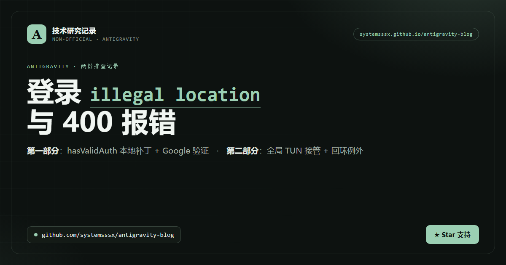

<p align="center">
  <a href="https://github.com/systemsssx/antigravity-blog">
    
  </a>
</p>

<h1 align="center">Antigravity 两份排查记录：登录 illegal location 与 400 报错</h1>

<p align="center">中文技术博客 · 单文件 HTML · 零外部依赖 · 支持亮 / 暗主题 · 适配移动端</p>

<p align="center">
  <a href="https://systemsssx.github.io/antigravity-blog/"></a>
  <a href="https://github.com/systemsssx/antigravity-blog/stargazers"></a>
  <a href="https://github.com/systemsssx/antigravity-blog/commits/main"></a>
  <a href="https://github.com/systemsssx/antigravity-blog/discussions"></a>
  <a href="LICENSE"></a>
</p>

<p align="center">
  <b>觉得这份排查记录有用？请到本仓库右上角点一个 ⭐ Star —— 这是对作者最直接的支持。</b><br>
  <sub>也欢迎 Watch 仓库，后续修订会同步推送到 Pages。</sub>
</p>

---

## 👉 在线阅读

**<https://systemsssx.github.io/antigravity-blog/>**

纯静态单文件：CSS / JS 全部内联，不引用任何外部字体、图片或 CDN，**断网也能正常阅读**；右上角可切换亮 / 暗主题。

## 这篇记录讲什么

| 部分 | 遇到的问题 | 处理思路 | 章节数 |
| :--: | --- | --- | :--: |
| **第一部分** | 登录被 `illegal location` 拦住，无法进入主界面 | 本地 `hasValidAuth` 补丁 + 按 `validation_url` 完成 Google 验证 | 4 节 |
| **第二部分** | 代理开着，Antigravity 仍报 **400** | 找出系统代理漏掉的流量 → 全局 TUN 接管 → 修复 localhost 回环 | 10 节 |

两部分互相独立，不需要连读。每部分都按「现象 → 操作 → 结果」展开，末尾给出可复核的验收标准。

## 快速导航

**第一部分 · 登录 illegal location**

- [TL;DR（结论先行）](https://systemsssx.github.io/antigravity-blog/#tldr)
- [问题现象](https://systemsssx.github.io/antigravity-blog/#symptoms)
- [三道关卡的判定模型](https://systemsssx.github.io/antigravity-blog/#model)
- [实际操作步骤](https://systemsssx.github.io/antigravity-blog/#steps)

**第二部分 · 代理开着却报 400**

- [引言：代理开着，却报 400](https://systemsssx.github.io/antigravity-blog/#p2-intro)
- [复现与日志证据](https://systemsssx.github.io/antigravity-blog/#p2-logs)
- [拆解：到底漏了哪些流量](https://systemsssx.github.io/antigravity-blog/#p2-leaks)
- [为什么系统代理救不了它](https://systemsssx.github.io/antigravity-blog/#p2-why)
- [解法一：开全局 TUN](https://systemsssx.github.io/antigravity-blog/#p2-tun)
- [怎么确认 TUN 真的生效](https://systemsssx.github.io/antigravity-blog/#p2-verify)
- [解法二：把回环修好](https://systemsssx.github.io/antigravity-blog/#p2-loopback)
- [排查流程图](https://systemsssx.github.io/antigravity-blog/#p2-flow)
- [边界与风险](https://systemsssx.github.io/antigravity-blog/#p2-limits)
- [结语与一页速查表](https://systemsssx.github.io/antigravity-blog/#p2-cheatsheet)

## 目录结构

```text
.
├── index.html          # 博客正文（单文件，Pages 首页）
├── assets/
│   └── og-card.png     # 社交分享卡片（Open Graph 1200×630）
├── README.md
├── LICENSE
└── .nojekyll           # 跳过 Jekyll，纯静态托管
```

## 本地查看

```powershell
start .\index.html
```

无需安装依赖、无需构建。仓库根目录直接推到 GitHub Pages 即可在线访问。

## 分享与社交卡片

页面已内置 Open Graph / Twitter Card 元信息，分享链接时会展示 `assets/og-card.png` 作为预览图：

```html
<meta property="og:image" content="https://systemsssx.github.io/antigravity-blog/assets/og-card.png">
<meta name="twitter:card" content="summary_large_image">
```

> **仓库主页的社交预览图**：GitHub 暂未开放通过 API 上传，可在仓库 `Settings → Social preview → Edit` 手动上传 `assets/og-card.png`（1200×630），只需设置一次。

## 反馈与讨论

- 💬 **Discussions（已开启）**：<https://github.com/systemsssx/antigravity-blog/discussions> — 欢迎先到 [欢迎帖](https://github.com/systemsssx/antigravity-blog/discussions/1) 打个招呼
- 🐛 **Issues**：<https://github.com/systemsssx/antigravity-blog/issues>
- ⭐ **Star**：<https://github.com/systemsssx/antigravity-blog>
- 👀 **Watch**：订阅后续修订

欢迎指出文中的事实错误、版本差异或补充更稳妥的方案。

## 版权与使用

本作品采用 [CC BY-NC-SA 4.0（署名—非商业性使用—相同方式共享 4.0 国际）](LICENSE) 许可协议：

- **署名**：转载请注明作者与原文链接（<https://github.com/systemsssx/antigravity-blog>）；
- **非商业**：不得直接用于商业目的；
- **相同方式共享**：修改后的作品需以相同协议发布。

## 免责声明

内容仅用于技术原理分析与问题排查记录，不构成对任何软件许可协议或服务条款的规避建议，也不保证所述方法长期有效。修改二进制文件、更改网络出口、使用 TUN / VPN 均可能违反服务条款、影响局域网与内网访问，并可能导致账号受限；相关风险与后果由操作者自行承担。
